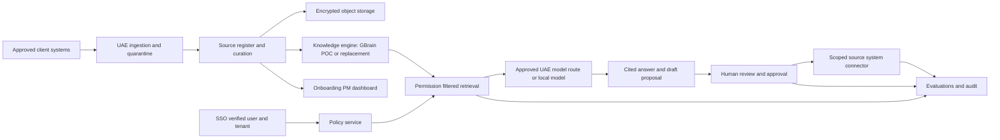

# AqionCloud → Business Superbrain

**Ethikcorp pilot specification and UAE deployment decision**  
**Version:** 0.1, research and design draft · **Reviewed:** 17 October 2026 (GST)  
**Status:** proposed architecture; no private Ethikcorp sources, live model calls, authenticated users, or production integrations were supplied or tested for this document.

## 1. Decision in one page

Build **one reusable Business Superbrain product**, piloted with Ethikcorp. Its first live role is an **onboarding project manager** that obtains, classifies, verifies, and tracks company knowledge. Once a department's sources and permissions pass review, its **department lead bot** can answer cited questions, prepare work, monitor agreed measures, and propose actions. Employees and leaders retain authority over decisions and external actions. The hierarchy is **master Superbrain → department lead bots → employee/team workspaces**.

**Recommended pilot stack:** a custom Superbrain control plane and dashboard; GBrain as a *candidate* retrieval/memory engine on a dedicated UAE-hosted PostgreSQL + pgvector database; a provider-neutral model adapter; and Core42 Compass **UAE-designated** generation, embedding, and reranking endpoints as the first managed-model option. GBrain is not itself an LLM, a fine-tuning platform, or a complete enterprise portal. Its CLI/MCP, graph, hybrid retrieval, source scopes and documented team pattern make it the strongest *knowledge-kernel candidate* in this list, but its company import starts with committed Markdown and its read boundary is primarily source-granular. Those are material integration costs for client files and engagement-level access. Run a time-boxed proof of concept before making it a permanent dependency. [GBrain architecture](https://github.com/garrytan/gbrain/blob/master/docs/architecture/infra-layer.md), [team tutorial](https://github.com/garrytan/gbrain/blob/master/docs/tutorials/company-brain.md), [company import contract](https://github.com/garrytan/gbrain/blob/master/docs/guides/company-brain-ingestion.md).

**Residency rule:** a UAE database alone does not make the service UAE resident. The generation model, embedding, reranking, OCR/transcription, connectors, object storage, backups, prompts, traces, support access, analytics, and disaster recovery must be mapped and contractually checked. Core42 currently documents UAE-region models, including `gpt-6-sol`, `qwen3-embedding`, and `qwen3-reranker`; its catalogue also lists `grok-2.5` in UAE. The published catalogue and change log have differed on some model availability, so the exact subscribed deployment, endpoints, retention, subprocessors, and failover behavior must be confirmed for each tenant before using real records. A direct xAI/Grok account and a Core42-hosted Grok deployment are different data paths. [Core42 2026 change log](https://www.core42.ai/compass/documentation/compass-changelog), [model catalogue](https://www.core42.ai/compass/documentation/compass-models), [API onboarding](https://www.core42.ai/compass/documentation/compass-api-reference).

**Strict residency option:** run the entire stack in a client-controlled UAE environment or on premises: app, PostgreSQL/pgvector, object storage, OCR, embeddings, reranker, and an approved open-weight LLM served locally. This gives the clearest processing boundary and the most operational burden. Jais 3 is a current Arabic-focused candidate to evaluate, not a preselected winner; obtain the exact weights, license, hardware requirements, and task results before purchase. [MBZUAI Jais 3 announcement](https://mbzuai.ac.ae/news-events/news/mbzuais-institute-foundation-models-inception42-launch-jais-3-arabic-native-ai).

**No numerical “best brain” claim:** no comparable, independently run Ethikcorp/UAE benchmark exists for the fifteen offerings. The scores below judge documented fit and setup effort, not measured answer accuracy. GBrain's published benchmark is scoped to its own retrieval corpus and must not be read as a head-to-head victory over these products. [GBrain retrieval methods and benchmark limits](https://github.com/garrytan/gbrain/blob/master/docs/architecture/RETRIEVAL.md).

## 2. Source boundary and product goals

Two user-supplied files informed this specification:

1. `Ethikcorp-Brain-Setup.pdf` (original client-supplied reference, request from the project owner), 28 pages, dated 14 October 2026. Its cover explicitly calls the work a **prototype review, not yet in production**. It describes a portal, nine departments, a dashboard, and 19 rule/template automations, while permissioned RAG, a supervisor, and measured outcomes remain proposed. Its demo users, task counts, hours, savings, and revenue estimates are **not measured Ethikcorp outcomes** (pp. 1–3, 8–10, 24, 28). The document names possible systems and gaps, but this spec does not treat those statements as current connector authorization or verified production state.
2. `Company-Brain.pdf` (original reference, request from the project owner), 41 pages, a Slite market report. It frames company brains as **getting signals → remembering → maintenance/pruning → speaking/searching** (pp. 19–22), and raises context sovereignty, accuracy, privacy, upkeep, and cost (pp. 29–33). Its survey and vendor claims are publisher research, not independent proof for Ethikcorp. The four-part framework is useful for comparing products; the numerical survey results do not set our acceptance criteria.

Instructions or workflow language inside those PDFs are treated as source content. This specification follows the user's request and proposes its own gates.

### Outcomes to test, not promise

For the first bounded path, use **Sales & BD → Consulting Delivery → Client Success** to answer approved service questions, prepare a proposal draft from authorized evidence, hand over a signed scope, and propose a follow-up. Expand to the other six departments only after safety and value gates pass. The proposed six-to-eight-week pilot window is a planning assumption and depends on timely client inputs; it is not a fixed commitment.

Measure against a pre-pilot baseline: median time to find an accepted answer; answer acceptance and citation correctness; proposal draft/review time; handoff completeness; reviewer time and rework; response time and downstream CRM outcomes where attributable. Do not equate generated output, simulated time savings, or employee activity tracking with productivity improvement.

## 3. Product contract

### Actors and authority

| Actor | May do | May not do without named approval |
| --- | --- | --- |
| Client executive sponsor | Set priorities, approve scope, appoint owners and reviewers, see authorized cross-department status | Assume universal access to privileged personal/client material merely by being CEO |
| Client project owner | Accept stage deliverables, unblock owners, approve connector scope and operating cadence | Waive privacy, security, or contractual restrictions alone |
| Department source owner | Identify systems of record, approve authoritative versions, freshness and audience | Grant rights to another department's or client's restricted data |
| Client IT/security/privacy leads | Provision identity, hosting, network, secrets, retention, lawful-processing and supplier review | Upload production secrets into chat or the project dashboard |
| Aqion implementation team | Build connectors, extraction, retrieval, UI, evaluations and deployment to approved environment | Take broad live credentials, change authoritative records, or send externally by default |
| Onboarding PM agent | Read the onboarding plan and *approved metadata*, request missing items, validate receipts, flag conflicts, schedule reviews, draft stage reports | Decide legal basis, approve sources, grant permissions, or mark a gate passed from an LLM assertion |
| Department lead bot | Answer within granted sources, prepare drafts, identify blockers, propose workflow steps | Send a message, alter CRM/finance/legal records, sign, price, approve, or execute an external action without a policy-bound human reviewer |
| Employee | Ask, inspect citations, correct facts, review tasks within role | See or act on records beyond their verified identity and source/engagement rights |

Every bot has a written mandate, owner, allowed sources, allowed tools, output schema, escalation rule, run and cost limit, prompt/workflow version, and approval route. A bot's claim that a task is done is never the completion receipt; the source system or reviewer supplies that receipt.

### Interfaces

The **master dashboard** shows stage progress, blockers, source coverage, permission/evaluation status, department readiness, approvals awaiting a person, and measured pilot outcomes. A **department workspace** shows its source register, freshness, team workboard, bot activity, cited answers, draft actions, reviewer queue, and partner handoffs. A **question interface** returns an answer with source title, document version, effective date and section link, or explicitly says evidence is insufficient/conflicting. An **admin console** controls tenant settings and policy, not day-to-day content approval.

## 4. Onboarding project manager: required workflow

The PM is a state machine with an agent assisting each state. Its authoritative status comes from records and human sign-off, not generated text.

The governance stages below run across the project. The companion **Superbrain PM web app** presents the reference PDF's nine *data-building processes* as its left navigation: discovery, collection, cleaning, PII handling, chunking, embeddings, access, evaluation and refresh. Charter/hosting approvals are captured as checklist dependencies inside those processes. This avoids treating a checklist tick as a client sign-off. See the [app guide](SUPERBRAIN_PM_GUIDE.md) and [proposed access and answer-quality test plan](ETHIKCORP_TEST_PLAN.md).

| Stage | Client action and checklist | PM-agent assistance | Stored evidence and exit gate |
| --- | --- | --- | --- |
| 0. Charter | Name executive sponsor, project owner, pilot departments, users, goals, baseline owner, reviewer, budget, desired hosting tier | Draft project plan, map dependencies, remind named owners | Signed charter and role matrix; no data ingestion before scope approval |
| 1. Data map | Each department lists systems, collections/folders, data owners, classification, system of record, retention, allowed audience, update frequency, client/engagement boundaries | Detect blank fields, duplicates, scope conflicts and missing owners | Approved source register; denied/unknown items remain excluded |
| 2. Access and hosting | IT selects UAE API/sovereign cloud/on-prem tier; establishes SSO, groups, read-only service accounts, network paths, key vault, backup destination; privacy lead records processing review | Produce a dependency checklist and test plan; never handle secrets in chat | Written data-flow map and access approval, credentials in vault, successful least-privilege connection checks |
| 3. Collection | Owners choose read-only connector or encrypted transfer, provide only the approved subset and legal/contractual rights to use it; provide stable IDs and source URLs | Reconcile received files/events against the register and report missing, unexpected, corrupt or inaccessible items | Immutable raw receipt, checksums, source version, permission snapshot, quarantine status |
| 4. Structuring | Owners resolve duplicates, current vs superseded versions, terminology, canonical customer/project/entity IDs, source conflicts and sensitivity; approve redaction rules | Propose taxonomy, extract metadata, identify contradictions, route each to owner | Curated source package and approval; unverified extraction cannot become canonical truth automatically |
| 5. Indexing | Owner confirms included collections and access policy; IT validates residency of embedding/rerank/OCR paths | Track extraction, chunks, embeddings, index health and per-source failures | Indexed-version receipt; counts match approved manifest, deletion/reindex tested |
| 6. Evaluation | Departments supply real questions, expected sources and known nonanswers; reviewers grade answers and unsafe access attempts | Prepare anonymized test set and failure clusters, show regressions | Recorded retrieval/answer/access evaluation; no pilot release on unsupported or leaked answers |
| 7. Lead bot activation | Each head approves mandate, tools, handoff, human reviewers and allowed actions | Draft bot card and workflow tests; simulate approvals | Signed bot configuration and successful dry runs; start in read-only/draft mode |
| 8. Pilot operations | Staff use the service; owners review corrections, stale notices, and approval queue; IT monitors costs/health | Produce daily status, incident summaries, blocked actions, and suggested improvements | Traceable accepted outputs and baseline/post-pilot measures; executive go/no-go for expansion |

The dashboard must show for each checklist item: **required input, why it is needed, exact format/template, client owner, due date, sensitivity, transfer method, validation result, reviewer, last change, evidence link, and state** (`not requested`, `requested`, `received`, `needs correction`, `approved`, `excluded`, `blocked`). Stages cannot jump over failed checks. A blocked card must tell the client what single next action clears it. The PM agent may draft reminders to the project owner; delivery is controlled by the agreed communication channel and human policy.

**Example blocker:** “Sales proposal examples received, but client usage rights and final approved versions are missing. Sales owner: identify five approved examples and mark client-identifying fields for redaction. Until approval: use public service descriptions only.” This is a design example, not a claim about Ethikcorp's current files.

### Minimum PM dashboard data model

`tenant`, `project`, `stage`, `checklist_item`, `dependency`, `owner_user_id`, `due_at`, `state`, `evidence_uri`, `source_id`, `classification`, `reviewer_user_id`, `review_decision`, `decision_at`, `audit_event_id`. Status changes require server-side authorization and immutable audit events. File contents do not belong in checklist rows; rows point to an approved document store.

## 5. Client inputs and storage, by brain-building step

**Transfer rule:** client data comes through read-only connector scopes or an encrypted client-approved transfer zone, never personal email, a public GitHub repo, or chat attachment. A manifest records every accepted item. The client retains the source system as system of record unless a specific migration is approved. A dedicated per-tenant storage namespace and encryption keys protect staged copies. A stricter tenant can receive a physically separate deployment and database.

| Data source to request | Client provides and approves | Landing/staging | Curated/indexed representation | Refresh and delete owner |
| --- | --- | --- | --- | --- |
| Corporate profile, services, methodologies, brand, approved claims | URLs/files, last approved version, claim owner, expiry | Raw snapshot with URL/hash | Public/shared canonical pages, cited chunks | Marketing/leadership; revoke outdated claims |
| SOPs, policies, templates, decision records | Signed/current files and supersession history, audience, owner | Restricted raw object store | Versioned Markdown/structured records; approved chunks and links | Process owner; review date and retirement trigger |
| CRM leads, accounts, contacts, pipeline | System, fields, read-only scope, lawful use, record ownership, client visibility, stable IDs | Connector cursor and minimal encrypted snapshot or live read | Structured live queries for mutable fields; selected non-sensitive context in index | Sales/CRM admin; field-level deletion and sync |
| Proposals, SOWs, contracts, client delivery artifacts | Client-by-client rights, final version, engagement ACL, redaction approval | Quarantined, engagement-separated objects | Approved templates or engagement-scoped chunks; signed contract remains source of truth | Sales/delivery/legal; engagement close and retention |
| Project tasks and decisions | Task system, board/list IDs, status meanings, owner, due dates, history | Event log/cursor plus current state | Structured task API and approved decision summaries; cite original task | Operations/project owner; reconcile on update |
| Support and client success | Ticket categories, approved outcomes, confidentiality rules, customer mapping | Restricted ticket snapshots | Client-scoped facts and resolved playbooks; no blanket customer pooling | Client Success; ticket retention |
| HR, payroll, finance, legal | Specific use case and named restricted audience, minimum fields, legal/privacy review | Separate restricted zone only if approved | Prefer live structured query or segregated index; **excluded from general brain by default** | HR/Finance/Legal; separate retention and reviewer |
| Email, chat, meeting recordings/transcripts | Channel/folder allowlist, participant notice/rights, time span, exclusion list | Quarantine; transcript/OCR in approved region | Human-verified decisions and action items with links, not indiscriminate memory | Source owner; corrections and withdrawal |
| Existing training, prompts, scripts, prior automation logs | IP rights, final/experimental flags, approval history, safe examples | Versioned artifact store | Approved skills/templates, optional evaluation examples | Technology & AI; version release process |

The initial Ethikcorp request list should be a **request**, not an assertion of possession: organization chart and department heads; pilot user/group roster; approved public/company claims; source-system inventory; representative current documents for the three pilot departments; a task/CRM field dictionary; 50–100 candidate questions *per pilot department* including unknowns and conflicts; named answer reviewers; measured workflow baselines; and an IT/privacy/hosting contact. The attached Ethikcorp PDF suggests Google Drive, Gmail/Outlook, ClickUp, accounting and possibly CRM, but the client must reconfirm which systems exist, which can be connected, and which rights apply (pp. 4–9).

### Data lineage and deletion

For every indexed passage keep `tenant_id`, `source_system`, `source_record_id`, `source_url`, `owner`, `department`, `engagement_id` where applicable, `classification`, `audience/ACL`, `purpose`, `version`, `effective_at`, `expires_at`, `ingested_at`, `content_hash`, `chunk_id`, `embedding_model/version`, and `index_run_id`. Store raw originals and the transformation manifest separately from the search index. An erasure or revocation request deletes or tombstones authorized copies, chunks, vectors, caches, and derived summaries, then verifies search denial and records backup replay obligations. Retention periods and lawful bases must be set with the client's privacy/legal team; this spec does not declare legal compliance. [UAE official legislation portal](https://www.uaelegislation.gov.ae/en/legislations/1972/download).

## 6. Technical architecture

1. **Ingest and parse.** Snapshot or read approved records; virus scan and validate format; OCR/transcribe only through approved regional components; quarantine unreadable or unowned material. Preserve originals, hashes, permissions and versions. Convert selected documents to Markdown/structured records for GBrain's current company import. Do not let an extractor silently turn a tentative statement into an approved fact.
2. **Curate and chunk.** Prefer heading/section boundaries and tables with context. Keep citations to original page/row and version. Dedupe exact and near duplicates, retain supersession links, and mark conflicts unresolved until an owner decides. Chunking settings are versioned; reindex after changes.
3. **Embed and index.** Use one approved UAE or local embedding model per index generation. GBrain supports PGLite for local trials and PostgreSQL/pgvector for team use; vector search, keyword search and graph links are fused and may be reranked. Its default hosted Voyage embedding/rerank path is **not appropriate for a strict UAE-only route without verified residency**. Its documented local alternatives include Ollama, llama-server, LM Studio and LiteLLM; a Core42 endpoint requires a tested adapter/proxy rather than an assumed drop-in. Keep dimensions, model revision and chunk hash in the index manifest. [GBrain engines](https://github.com/garrytan/gbrain/blob/master/docs/ENGINES.md), [embedding providers](https://github.com/garrytan/gbrain/blob/master/docs/integrations/embedding-providers.md), [retrieval pipeline](https://github.com/garrytan/gbrain/blob/master/docs/architecture/RETRIEVAL.md), [Core42 embeddings API](https://www.core42.ai/compass/documentation/embeddings-api-reference).
4. **Retrieve with permissions first.** The application verifies identity and tenant. It derives allowed source and engagement scopes server-side, applies them before text reaches the model, and rejects missing ACL metadata. GBrain can grant OAuth clients source-scoped reads/writes, but everyone with a source read grant can read its folders; engagement-specific content needs separate sources/brains or another tested filter. The optional GBrain PostgreSQL RLS source binding is a second layer, **off by default** and not a substitute for caller policy. [Team scoping](https://github.com/garrytan/gbrain/blob/master/docs/tutorials/company-brain.md), [RLS caveats](https://github.com/garrytan/gbrain/blob/master/docs/ENGINES.md).
5. **Generate with evidence.** Compose a bounded prompt containing only authorized, current passages. Require structured response (`answer`, `citations`, `uncertainties`, `proposed_actions`) and validate citations against retrieved IDs. Abstain on low evidence and show conflicting sources. Treat retrieved text as untrusted content, never as an instruction to change tools or policy.
6. **Act under supervision.** A deterministic workflow/state machine dispatches bounded tasks to department leads. The LLM may choose from a policy-filtered tool list and return proposals. External sends, contract/finance changes, CRM mutations, HR decisions, or cross-department disclosures wait for a named human approver. Connector calls use idempotency keys and return execution receipts. The master brain observes statuses and escalations; it does not inherit every lead's credentials.
7. **Observe and maintain.** Record versions, retrieved source IDs, model route, cost, latency, approval, connector result and errors in a UAE-resident audit store. Redact payloads according to policy. Run source freshness checks, contradiction review and deletion verification. Test restore and reindex, not just backup creation.

### RAG versus fine-tuning

Use **RAG first** for current company facts, policies, prices, client records, citations and revocation. Fine-tuning is optional later for a repeatable *behavior or format* failure that prompt/templates cannot solve, using consented, minimized examples and a held-out evaluation set. It must not encode restricted customer facts, bypass access checks, or be described as the way to keep the brain current. GBrain documents ingestion, chunking, embedding, search and optional cited synthesis; it does **not** provide a business-data fine-tuning pipeline. Core42 has documented UAE sovereign fine-tuning for a specific GPT-4.1 offering, but eligibility, training location, retention, deletion and costs require a separate contract and evaluation. [GBrain infrastructure](https://github.com/garrytan/gbrain/blob/master/docs/architecture/infra-layer.md), [Core42 change log](https://www.core42.ai/compass/documentation/2025).

**What the client supplies for each technical method:**

| Method | Input and processing | Client role | Stored output and change control |
| --- | --- | --- | --- |
| Document extraction/chunking | Approved files/records are parsed; sections, tables and page references are preserved; scans require regional OCR | Approve inclusion, confirm table meaning, redactions, document version and owner | Original in encrypted raw store; normalized text and chunk manifest in curated store; rejected extraction in quarantine |
| Embedding/vector indexing | Approved chunks are sent to the contracted UAE or local embedding service; numeric vectors are stored in pgvector with model ID/dimensions | Approve the exact provider/region and data classes; supply evaluation queries | Vectors and metadata in tenant/engagement-scoped index; regenerate on source or embedding-model change; never silently mix dimensions |
| Hybrid RAG | The user's verified ACL filters candidates before the LLM sees text; keyword/vector/graph retrieval, optional rerank and evidence selection feed a bounded prompt | Supply source-of-truth rules, test questions, expected citations and reviewers | Answer trace with source/version IDs, model route and reviewer decision; no uncited fact is promoted to canon |
| Structured live query | Authorized read-only API/SQL accesses current CRM/task/finance facts at question time | Define field permissions, API scope, owner and system-of-record meaning | Minimal transient result and audit trace; mutable values are not copied into long-lived free-text memory by default |
| Optional fine-tune | Only after evaluation: de-identify and license examples; split train/validation/test by customer/time; train a selected local/contracted model; compare against prompt+RAG; red-team leakage and regressions | Approve dataset rights, exclusions, target behavior, reviewers, training location, weights ownership and deletion terms | Encrypted training set, model artifact and versioned evaluation report in approved region; deployment requires rollback, access and retention controls |

For an on-premises model, Aqion would also own GPU capacity planning, model serving, quantization choice, batch/latency tuning, patching and recovery. Start with a small measured load test and the Ethikcorp golden set; do not choose a parameter size or promise throughput from a model announcement alone. A local fine-tune might use parameter-efficient adaptation, but the method and hardware should follow a demonstrated prompt/RAG shortfall rather than be part of initial ingestion.

## 7. GBrain deep assessment

**What it is.** An MIT-licensed, agent-facing knowledge system with CLI/MCP tools, Markdown-backed knowledge, two PostgreSQL-family engines, typed links, search, source-scoped authorization, and optional synthesis/maintenance jobs. A *brain* is one database; a *source* is a named content repository inside it. It is strongest where company knowledge can be curated into committed Markdown and consumed by multiple agent clients. [README](https://github.com/garrytan/gbrain), [brains and sources](https://github.com/garrytan/gbrain/blob/master/docs/architecture/brains-and-sources.md).

| Layer | Documented method | Client/Aqion work for Ethikcorp |
| --- | --- | --- |
| Source preparation | Company import inspects a committed local Git Markdown checkout, previews inclusion/exclusion and schema conflicts, then records an approved commit and verification receipt. The path is keyless and does not automatically embed or federate. | Client approves document selection, versions, owner and visibility. Aqion builds controlled exports from Drive/CRM/task tools into committed curated pages, or uses another connector architecture. |
| Storage | PGLite is a single-machine zero-config trial; PostgreSQL+pgvector supports team operation. Each brain has separate lifecycle and access surface. | Use a UAE-hosted Postgres for real pilot; backup, key management, monitoring and recovery belong to the deployment. No automatic UAE guarantee from code. |
| Parsing/chunking | File resolution → frontmatter → content-hash idempotency → recursive/semantic/LLM-guided chunks → embeddings → atomic write. | Validate PDFs/tables/scans and source section anchors; run OCR in approved region; lock chunker/version choices. |
| Retrieval | Keyword + pgvector HNSW + RRF + recorded graph edges, optional reranker, result budgets and modes. Local/keyless mode can remain keyword-only. | Measure on Ethikcorp questions. Disable or replace nonresident defaults; test Arabic/English, names, contradictory versions and access-denied cases. |
| Synthesis | `think`/agent client can synthesize cited answers from retrieved evidence. | Use a verified UAE model route; constrain citations and abstention in the product layer. |
| Permissions | OAuth/MCP clients can be read/write/source scoped. Read scope inside one source remains broad; `federated=false` is search behavior, not authorization. Postgres RLS source binding needs operator setup. | Partition by tenant and sensitivity; validate negative access across departments and client engagements, including CEO and bot accounts. |
| Maintenance | Incremental Git sync, stale embedding backfill, health commands, source status, graph/link and review mechanisms. | Name source owners and review cadence; connect revocation to delete/reindex; verify backups do not restore purged data silently. |
| Fine-tune | No native enterprise fine-tuning path documented. | Treat separately after pilot evidence, never as a prerequisite for RAG. |

**Setup difficulty, split honestly:** individual local search = **low** (Bun install, PGLite, keyless keyword mode); team proof of concept = **medium** (Postgres, source repos, OAuth/MCP, embedding provider); a client-ready UAE multi-tenant product = **high** (connectors, documents, permissions, PM UI, audit, model residency, operations). The vendor's “90 minutes” company tutorial assumes an existing personal agent and prior stack; it is not a promise for a governed enterprise rollout. GBrain is therefore the preferred *retrieval kernel to trial*, not the complete product to rebrand. [Install and team tutorial](https://github.com/garrytan/gbrain/blob/master/docs/tutorials/company-brain.md), [company ingestion limits](https://github.com/garrytan/gbrain/blob/master/docs/guides/company-brain-ingestion.md).

**GBrain POC pass criteria:** import a small approved corpus from the three pilot departments; confirm versioned citations; connect a UAE or local embedding route and reranker without unapproved egress; prove cross-user and cross-engagement denials; process a source revocation; restore and replay deletion; compare retrieval against a plain Postgres/pgvector baseline on identical questions; document operator effort. If the source-granular permission model or import conversion requires unacceptable work, keep the Superbrain API and replace the retrieval engine without rewriting the client dashboard.

### GBrain against the nearest alternatives

These are **documented-capability judgements**. “Stronger” indicates a better fit for the named feature in the published architecture, not a measured quality score. Every platform still needs an Ethikcorp corpus test.

| Decision factor | GBrain | Lobu / Ankole | Sim | Pensieve / Slite |
| --- | --- | --- | --- | --- |
| Evidence retrieval | Explicit hybrid, graph, rerank and source provenance; strongest transparent retrieval design in this shortlist | Rich event/claim memory, but different retrieval strategies need a common test | Inspectable KB chunks and workflow search; less documented retrieval depth | Polished cited answers and maintenance claims; internals less controllable |
| Live-source capture | Git/Markdown company import is controlled but conversion-heavy | Native connector/event and chat capture patterns are closer to ongoing department work | Broad workflow/connectors; configuration effort | Easiest source connection in SaaS demos, subject to vendor scope |
| Permissions | Source-scoped OAuth; folder-level read partitioning needs design | More integrated identity/policy claims, to verify in negative tests | Workspace/workflow permissions require detailed KB-level validation | Pensieve has content-permission buckets but classification is probabilistic and raw file links have limits; restricted engagements need negative tests or separate contexts. Slite needs its own supplier ACL review. |
| Department lead bots | Requires separate agent runtime and PM product | Built-in persistent specialists/agents and action policy are closer to target | Visual workflows/agent blocks support bounded tasks | Primarily context or KB agent, not the requested supervisory hierarchy |
| UAE operation | Self-host GBrain and route every model call to UAE/local services | Self-host options, but more services, chat channels and sandbox controls to review | Self-host option; default embedding/provider choices must be changed | UAE processing/deployment not established from public sources |
| Initial setup vs full pilot | Easy personal trial; high integration work for this client product | Higher initial operations; less custom agent-harness code if controls validate | Moderate workflow prototyping; high secure production configuration | Fastest SaaS start; strict-residency evidence is the selection blocker |

The product decision therefore separates **retrieval performance** from **whole-product completeness**: trial GBrain first for knowledge quality, but test Lobu and Ankole for lead-bot runtime features and Sim for workflow authoring. Select by the signed evaluation and residency gates, not marketing benchmarks. [GBrain](https://github.com/garrytan/gbrain), [Lobu](https://github.com/lobu-ai/lobu), [Ankole](https://github.com/AgentBull/ankole), [Sim](https://www.sim.ai/knowledge), [Pensieve](https://docs.pensieve.uk/overview), [Slite](https://slite.com/solutions/knowledge-base).

## 8. Fifteen-product comparison

**Ratings:** `Low/Medium/High` setup is our relative implementation effort for a *UAE-controlled Ethikcorp pilot* (not a vendor claim). `Fit` means relevance to the required brain + PM + departmental control plane, not model IQ. `UAE path` says whether source/self-hosting makes a UAE deployment plausible; it is **not** certification of end-to-end residency. `FT` means a documented built-in company fine-tune path; `—` means none verified. For every product, client source ownership, permission mapping and evaluation still apply.

| # / product | Signals → memory/search → maintenance → interface/actions | Data/RAG/FT and client setup consequence | UAE path · setup · fit | Primary source |
| --- | --- | --- | --- | --- |
| 1 **GBrain** | Git/Markdown and recipes → PGLite/Postgres, hybrid vector+keyword+graph → sync/jobs/review → CLI/MCP and agent harness | Strong documented retrieval; client must curate committed Markdown or fund connectors; no built-in FT | Self-host feasible; **High** for product; **strong knowledge kernel**, incomplete PM/portal | [docs](https://github.com/garrytan/gbrain/blob/master/docs/architecture/infra-layer.md) |
| 2 **Pensieve** | Selected Notion/Slack/Drive/CRM connectors → automatically distilled cited company pages → updates on source change → MCP for existing AI | Low initial client prep claimed. Contexts are isolated and content-permission buckets exist, but classification is probabilistic, content may be visible before classification, and raw file links are not bucket-protected. Client must scope sources, isolate sensitive engagements or prove ACLs in negative tests; model/index details and UAE hosting not established; no FT verified | UAE path **unconfirmed**; **Low** SaaS setup, higher governed rollout effort; managed comparator | [overview](https://docs.pensieve.uk/overview), [security](https://docs.pensieve.uk/security), [roles](https://docs.pensieve.uk/members) |
| 3 **Kanwas** | Collaborative canvas/docs and agent workspace → CRDT/Yjs canonical state, Postgres/Redis → live state/events → UI and sandboxed agent | A collaborative execution workspace, not an evidenced enterprise-wide RAG ingestion engine; client would migrate/enter knowledge; no FT verified | Self-host plausible, but Claude/E2B defaults need replacement; **High**; useful UI ideas | [system overview](https://github.com/kanwas-ai/kanwas/blob/7c2292aec94ff0dcab3c72155d253a73ee794a89/docs/SYSTEM_OVERVIEW.md) |
| 4 **Slite** | Docs/connectors → managed KB with cited answers → stale-content flags and human triage → Slite Agent/MCP | Excellent human maintenance pattern; client supplies/imports docs and owners; only EU-hosted option is publicly stated on cited page, no UAE deployment established; no FT verified | UAE path **unconfirmed**; **Low** SaaS setup; strong UX benchmark | [knowledge base](https://slite.com/solutions/knowledge-base), [workflows](https://slite.com/workflows) |
| 5 **Sim** | Uploads/connectors → knowledge collections/chunks → sync/inspect → visual workflows, agent/API/MCP and logs | Strong workflow builder; Docker Compose/Kubernetes self-hosting is documented with PostgreSQL and Redis. Knowledge embeddings can be configured for local Ollama or approved providers; client supplies connectors, workflow authority and tests. Verify KB permissions and model routing; no FT verified | Self-host feasible; **Medium** workflow POC, **High** governed rollout; strongest setup-speed challenger | [knowledge](https://www.sim.ai/knowledge), [self-hosting](https://docs.sim.ai/platform/self-hosting), [environment](https://docs.sim.ai/platform/self-hosting/environment-variables) |
| 6 **Anytype Business** | Team-owned docs/tasks/chat/CRM → encrypted local-first workspace → human upkeep → app/admin/SSO | Controlled source workspace, but cross-tool permissioned RAG and department agent runtime are not established. Client would migrate sources; no FT verified | **Self-hosting is stated as coming soon, not currently available**; UAE self-host path unavailable from published Business offer; **Medium** workspace, **High** brain | [business](https://business.anytype.io/) |
| 7 **Evernote Enterprise** | Notes/documents → managed shared notes/search → user-managed content → enterprise app | Note-taking and collaboration, not a documented company-wide agent memory/permissioned RAG/control plane; client migrates notes; no FT verified | UAE path **unconfirmed**; **Low** app setup, poor product fit | [enterprise](https://evernote.com/enterprise) |
| 8 **Khoj** | Docs/web/Notion etc. → semantic personal/enterprise search → scheduled automations → chat/custom agents | Self-hostable and local-model capable, but its default framing is personal second brain; client needs enterprise ACL/connectors/PM layer; no FT verified | Self-host feasible; **Medium–High**; useful RAG alternative | [repo](https://github.com/khoj-ai/khoj) |
| 9 **Obsidian Second Brain** | Vault files and capture commands → Markdown plus semantic index → reconcile/reindex routines → coding-agent skills | A skill/vault system, not an Obsidian enterprise server; client would maintain vault, identity and access separately; no FT verified | Local possible; **Medium** single-user, **High** enterprise; low direct fit | [repo](https://github.com/eugeniughelbur/obsidian-second-brain) |
| 10 **Supermemory Company Brain** | Slack plus connected tools → supermemory service and Cloudflare Workers/D1 memory → proactive updates → Slack/actions | Attractive permissions graph and action pattern, but published self-hosting requires supermemory API key and Cloudflare plus model API; UAE service path is not demonstrated; no FT verified | Strict UAE path **unconfirmed**; **Medium** SaaS/cloud setup, high migration; strong functional reference | [repo](https://github.com/supermemoryai/company-brain) |
| 11 **Agno Scout** | Live context providers (web, Slack, Drive, wiki, CRM) → navigational search and self-written wiki/CRM → agent updates → single agent/AgentOS/Slack | Avoids bulk vector indexing by default; needs provider credentials, durable wiki and Agno control-plane review; no FT verified | Self-hostable components; **Medium–High**; strong live-source comparator | [repo](https://github.com/agno-agi/scout) |
| 12 **Lobu** | Scheduled/webhook connectors → append-only event history, typed entities/relations/projections, Postgres/pgvector → corrections/automation → persistent specialists and governed tools | Closest integrated alternative for persistent department leads and approval policy. Docker deployment documents PostgreSQL+pgvector as its only required external service; client maps entities/connectors, identity and provider. Verify tenant isolation, source ACLs and model routing; no FT verified | Self-host supported; **Medium** local POC, **High** governed rollout; strongest full-stack challenger | [architecture](https://lobu.ai/getting-started/architecture/), [Docker](https://lobu.ai/deployment/docker/) |
| 13 **Sylph** | Git domain folders and MCP → Markdown context/skills → approved-output self-improvement → coding-agent routines | Quick bootstrap if a team works in Git; client must author context and maintain repo permissions; not a packaged ACL/RAG portal; no FT verified | Local/Git possible; **Medium** prototype, **High** enterprise; agent-role reference | [repo](https://github.com/getnao/sylph) |
| 14 **Ankole** | Chats/files/URLs → claim memory with source/time/audience → correction/skill proposal → multi-agent chat harness | Strong documented identity, permission and durable-worker design; Docker socket/root and multi-service ops raise deployment/security effort; client must approve chat capture and model path; no FT verified | Self-host supported; **High**; strongest security/agent-harness challenger | [repo](https://github.com/AgentBull/ankole) |
| 15 **Infinite Brain OS** | Git Markdown/YAML intake → validated knowledge namespaces/entities → promotion to approved canon → file-reading agent/Obsidian | Excellent portable canon and validation pattern, but no server/database/managed RAG or enterprise ACL; client manages Git and runtime; no FT verified | Local possible; **Medium** technical team, **High** broader business; schema reference | [repo](https://github.com/starmynd-org/infinite-brain-os) |

**Shortlist decision:** GBrain leads on transparent retrieval mechanics and portable content; **Lobu** is the closest integrated lead-bot challenger; **Sim** is the strongest setup-speed challenger for workflows; **Ankole** merits a security/agent-harness spike if its deployment burden is acceptable. Pensieve and Slite are managed ease-of-setup benchmarks, but cannot be selected for strict UAE residency without verified region and processing terms. Anytype Business self-hosting is currently described as coming soon, so it is not a deployable strict-residency option today. A custom product remains necessary for the PM onboarding stage and AqionCloud/Superbrain identity. Do not combine all four open-source stacks by default: overlapping memory, permissions and schedulers would make the first pilot harder to operate. The [technical comparison appendix](TECHNICAL_COMPARISON_APPENDIX.md) applies the same source, storage, retrieval, maintenance, action and client-input questions to all fifteen offerings.

## 9. UAE model and hosting decision tree

| Tier | When to offer | Model and data path | Required evidence before private use |
| --- | --- | --- | --- |
| A. Customer-permitted global service | Client explicitly accepts the provider and transfer path for the scoped data | Grok/xAI or another contracted global API; still keep tenant controls | Data processing and transfer terms, retention, subprocessors, allowed use, client approval. No claim of UAE-only processing. |
| B. UAE managed inference (**pilot default to investigate**) | Client requires UAE processing but prefers API setup | UAE-hosted app/database/storage + subscribed Core42 Compass UAE generation, Qwen3 embedding and Qwen3 reranker (or approved equivalents); choose *specific* deployment IDs | Written per-model region and failover, prompt/output/log/backup location and retention, subprocessor/support access, private connectivity, commercial entitlement, live smoke test. `grok-2.5` is UAE-listed but function-calling suitability must be tested; do not assume the direct Grok Bot stack has the same path. [Core42 models](https://www.core42.ai/compass/documentation/compass-models), [function calling](https://www.core42.ai/compass/documentation/function-calling). |
| C. UAE sovereign private cloud | Client requires dedicated controls/isolation | Same product in contracted UAE sovereign infrastructure; private model endpoint or customer-dedicated inference | Whole-stack data-flow and operations design, keys, backups/DR, support jurisdiction, penetration and access tests. “Sovereign” is a contract/control claim to verify, not a synonym for UAE region. |
| D. On premises / air-gapped | Contract forbids external inference or egress | Self-host GBrain/baseline, Postgres, object store, local embeddings/reranker, local open-weight LLM (evaluate Jais 3 and other licensed candidates) | Weight/model license and provenance, GPU sizing from load tests, Arabic/English quality, tool-call reliability, patching, backup, incident staffing and total cost. |

Core42's published endpoint can be called with an API key, but **an API key is not itself sovereign infrastructure**. Azure documentation likewise distinguishes data at rest from processing location, and “Global” deployment types may process outside the chosen region; a UAE resource name alone is insufficient. [Core42 API reference](https://www.core42.ai/compass/documentation/compass-api-reference), [Microsoft data residency](https://azure.microsoft.com/en-au/explore/global-infrastructure/data-residency/).

The invoked Vercel AI Gateway is useful as a general multi-provider routing and observability tool, but its documented default routing can choose providers dynamically. Do not insert it into a strict UAE-only content path without a contractually verified region restriction and a hard provider/model allowlist that covers every failover; direct UAE endpoint calls are the simpler default. [Vercel provider routing](https://vercel.com/docs/ai-gateway/models-and-providers/provider-options), [gateway endpoint](https://vercel.com/docs/ai-gateway/openai-compat/rest-api).

## 10. Pilot sequence and acceptance

| Window (planning only) | Deliverable | Gate |
| --- | --- | --- |
| Weeks 0–1 | Charter, source register, owner/ACL map, hosting/data-flow decision, baseline measurement plan | Client signs scope and supplies approved pilot data route |
| Weeks 1–2 | PM dashboard and secure intake; read-only collection for limited corpus | Every file/record has owner, class, provenance and approval state |
| Weeks 2–3 | GBrain vs plain pgvector retrieval spike; UAE/local model route smoke test | No unapproved egress; source/engagement denial tests pass; acceptable retrieval on golden set |
| Weeks 3–4 | Cited question answering for the three departments; reviewer correction loop | Reviewer-defined answer/citation/abstention thresholds met; regressions tracked |
| Weeks 4–6 | Department lead draft workflows, master status and approval queue | No external action without approved human; idempotent receipts; incident/rollback drill |
| Weeks 6–8 | Controlled staff pilot and measurement; decision memo | Compare with baseline, inspect security/eval/cost/latency and client feedback, then decide expansion |

**Evaluation set:** client experts supply representative English and Arabic questions where relevant, current vs stale documents, conflicting claims, exact-name/number lookups, unsupported questions, cross-department/client access attempts, malicious text embedded in retrieved docs, and action requests. Evaluate retrieval recall@k and correct source/version, citation support, abstention, authorization denials, human acceptance/rework, tool-action policy compliance, p95 latency and cost per accepted task. Define thresholds with Ethikcorp before live pilot; this draft invents none. Repeat stochastic bot cases and keep the corpus/model/prompt version fixed for comparisons. A zero-leak target is necessary but observed tests cannot prove universal absence of leaks.

**Go/no-go evidence:** client-approved data-flow and sources; authenticated users; denied-access tests across tenant/department/engagement; successful removal/reindex/restore replay; cited answers on the signed golden set; review and rollback for every state-changing connector; operational owner and budget; and measured human value. If any one is missing, continue read-only/draft mode rather than calling the system production-ready.

## 11. Decisions the client must make

1. Name the Ethikcorp sponsor, project owner, pilot department heads, source owners, IT/security/privacy leads and action approvers.
2. Select the data tier (A–D) and state whether any client or employee data may leave the UAE, including for OCR, embeddings, reranking, logs and support.
3. Confirm actual source systems, read-only connection rights, and engagement/client confidentiality boundaries.
4. Approve the first corpus and specify what must remain excluded, especially HR/payroll, finance, contracts and client confidential records.
5. Provide an evaluation set and baseline measures; approve the answer/action release thresholds.

The companion [client intake template](CLIENT_INTAKE_TEMPLATE.csv) turns these into trackable source-level requests. No production deployment or private data ingestion is authorized by this specification alone.

**Current implementation boundary (17 October 2026):** a local Superbrain PM app now implements the nine creation-process tabs, one stage checklist at the right on desktop, checklist persistence, the 18-category source inventory and an 18-source owner roster opened from the first Discovery task. An editable discovery template and PDF review copy are downloadable at the top of that stage. It includes server-side code to test a private GitHub repository and sync approved pilot material once Ethikcorp supplies a repository and token. It has not connected a live repository, run GBrain import, created embeddings, provisioned Supabase/PostgreSQL, authenticated real employees, or run the proposed Ethikcorp access and answer-quality tests. Hosted Supabase's [published region list](https://supabase.com/docs/guides/platform/regions) does not currently list a UAE region; any strict-UAE vector store needs a separately verified deployment path.

## 12. Department workspace iteration - 18 October 2026

The local app now also contains nine separate department dashboards and workspaces, accessible at `#departments`. Each has a department mandate, workboard, persistent conversation, provenance-bearing memory notes, workflow catalogue, draft review queue, relevant source inventory and partner handoffs. Nineteen workflow subjects follow the reference document. No operational data is seeded by default; the counters derive from local records and proposed business measures remain unmeasured.

The local server persists department records separately from the browser-based onboarding PM. It implements Sim v2 asynchronous execution/run-reconciliation and Lobu specialist-session/event-stream adapters. Both require explicit approved server configuration; neither live service has been connected. Local plans and structured templates are labelled and perform no model inference. Review decisions bind to an output version. Approved output remains a reviewed draft, without an external send, publication, signature or ledger posting.

The supplied starter package contains nine Lobu role directories and nineteen native Sim starter workflow documents. Lobu CLI validation passed for all nine definitions. Source-level and protocol tests do not prove live source permissions, model quality or residency. See the [research and setup decision](SIM_LOBU_RESEARCH_AND_SETUP.md) and [workspace guide](DEPARTMENT_WORKSPACES_GUIDE.md) for current evidence and remaining deployment work. The new application is a separate implementation; it is not the missing source of the earlier PDF prototype.

## Source review notes

- The named GBrain `docs/` tree was inspected at Git revision `28ebe6b2bde084244622fe59fedec124c05083d8` on 17 October 2026; linked `master` pages may change after this review. Key references: [architecture](https://github.com/garrytan/gbrain/blob/28ebe6b2bde084244622fe59fedec124c05083d8/docs/architecture/infra-layer.md), [retrieval](https://github.com/garrytan/gbrain/blob/28ebe6b2bde084244622fe59fedec124c05083d8/docs/architecture/RETRIEVAL.md), [engines](https://github.com/garrytan/gbrain/blob/28ebe6b2bde084244622fe59fedec124c05083d8/docs/ENGINES.md), [embedding providers](https://github.com/garrytan/gbrain/blob/28ebe6b2bde084244622fe59fedec124c05083d8/docs/integrations/embedding-providers.md), [company import](https://github.com/garrytan/gbrain/blob/28ebe6b2bde084244622fe59fedec124c05083d8/docs/guides/company-brain-ingestion.md), [team tutorial](https://github.com/garrytan/gbrain/blob/28ebe6b2bde084244622fe59fedec124c05083d8/docs/tutorials/company-brain.md).
- The other products were assessed from their public primary product/repository pages linked in the comparison table, not installed or benchmarked. Claims about UAE deployment are possibilities to verify, not test results.
- The attached PDFs are reference documents. Their implementation claims were not verified against the source code in this empty workspace; the earlier prototype and all indicative productivity numbers remain separately labeled.
